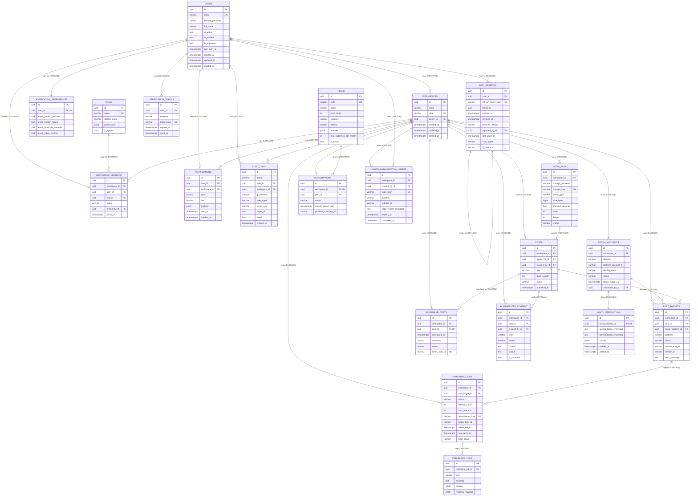

# Database Schema

Author: **Pramish Sharma**

> **Status:** Phases 2–13 complete. All **25** application tables are implemented
> as SQLAlchemy 2.0 models. The 16 core tables come from
> `0d24e6e89e59_create_core_tables`, seeded by
> `70ed893bdb70_seed_system_roles_and_plans`; the two authentication tables
> (`auth_sessions`, `verification_tokens`) are added by
> `14ae69daee8c_add_auth_sessions_and_verification_`; the OAuth authorization
> table (`oauth_authorization_states`) is added by
> `5347775d077d_add_oauth_authorization_states`; the two analytics snapshot
> tables (`post_metrics`, `account_metrics`) are added by
> `f241d12e080b_add_analytics_metrics`; the Phase 11 notification-delivery
> columns and the per-user `notification_preferences` table are added by
> `b8e2f5a91c47_phase11_notifications`; the Phase 12 AI-model registry +
> attempt log (`ai_models`, `ai_task_attempts`) are added by
> `c3f7a2e91d08_phase12_ai_models`; and the Phase 13 append-only `audit_logs`
> table is added by `d1a4b7c93e02_phase13_audit_logs`. `alembic check` reports
> **"No new upgrade operations detected"**, i.e. the models and the live
> PostgreSQL schema are in sync.

---

## 1. Conventions

| Concern | Decision |
| --- | --- |
| **Primary keys** | `uuid` (UUID v4). Generated in Python (`default=uuid.uuid4`) with `server_default=gen_random_uuid()` as a fallback for raw SQL inserts. |
| **Timestamps** | `created_at` / `updated_at` are `TIMESTAMPTZ NOT NULL DEFAULT now()`. `updated_at` has `ON UPDATE now()` via SQLAlchemy `onupdate=func.now()`. |
| **Soft delete** | `deleted_at TIMESTAMPTZ NULL` on `users`, `workspaces`, `social_accounts`, `media_files`, `posts`. Never a physical delete for these rows. |
| **Tenant isolation** | Every tenant-scoped table carries a `NOT NULL workspace_id uuid REFERENCES workspaces(id) ON DELETE CASCADE`. |
| **Enums** | `VARCHAR(32)` + a named `CHECK` constraint, **not** PostgreSQL native `ENUM`. New values are additive (`DROP`/`CREATE CONSTRAINT`) instead of `ALTER TYPE`, which cannot run inside a transaction. |
| **Constraint naming** | Deterministic `MetaData.naming_convention` (`ix_` / `uq_` / `ck_` / `fk_` / `pk_`) so Alembic autogenerate is stable. |
| **Composite index names** | Written explicitly (`ix_posts_workspace_created`) because the convention cannot name multi-column indexes from arbitrary expressions. |
| **JSON** | `JSONB` for `permissions`, `features`, `scopes`, `payload`, `context`, `response_payload`. |

### Enum catalogue (18 enums, `app/db/enums.py`)

`WorkspaceMemberStatus` · `SocialPlatform` · `SocialAccountStatus` ·
`StorageBackend` · `MediaStatus` · `PostStatus` · `PostTargetStatus` ·
`JobStatus` · `ScheduleStatus` · `LogLevel` · `AIContentKind` ·
`NotificationType` · `AIModelKind` · `AIModelStatus` · `AITaskStatus` ·
`BillingInterval` · `SubscriptionStatus` · `VerificationPurpose`

Enums are declared as `class X(str, enum.Enum)` and bound to columns through
`app/db/types.py::enum_column()`, which sets `native_enum=False`,
`create_constraint=True`, `validate_strings=True` and stores **values** (not
member names) via `values_callable`.

### Reusable mixins (`app/db/mixins.py`)

| Mixin | Provides |
| --- | --- |
| `UUIDPrimaryKeyMixin` | `id` UUID PK |
| `TimestampMixin` | `created_at`, `updated_at` |
| `SoftDeleteMixin` | `deleted_at`, `is_deleted` property |
| `TenantMixin` | `workspace_id` FK (CASCADE) + `scoped(workspace_id, include_deleted=False)` classmethod returning a filtered `Select` |

---

## 2. Entity-relationship diagram



---

## 3. Tables

### Identity & tenancy

| Table | Notes |
| --- | --- |
| `users` | `email` unique (320). Flags `is_active`, `is_verified`, `is_superuser`. Soft-deleted. |
| `workspaces` | The tenant boundary. `slug` unique. `owner_id → users ON DELETE RESTRICT` (ownership must be transferred before a user can be deleted). |
| `roles` | Global catalogue, `name` unique, `permissions` JSONB array of `resource:action` codes, `is_system` flag. |
| `workspace_members` | `UNIQUE (workspace_id, user_id)`, `role_id → roles ON DELETE RESTRICT`, `status` enum, `invited_by_id` SET NULL. |

### Authentication

| Table | Notes |
| --- | --- |
| `auth_sessions` | One login on one device, backed by a **rotating** refresh token. `refresh_token_hash` unique — only the SHA-256 digest of the opaque token is stored, never the token itself. `family_id` groups a rotation chain; `replaced_by_id → auth_sessions ON DELETE SET NULL` links each row to its successor so replaying a rotated token can revoke the whole family. `CHECK expires_at > created_at`. |
| `verification_tokens` | Single-use, expiring secrets for **both** email verification and password reset (`purpose` enum). `token_hash` unique (SHA-256 digest only). Consumption is recorded in `used_at` rather than deleting the row. `CHECK expires_at > created_at`. |

### Social accounts

| Table | Notes |
| --- | --- |
| `social_accounts` | `UNIQUE (workspace_id, platform, platform_account_id)` — the same platform account cannot be connected twice in one workspace. Soft-deleted. |
| `oauth_credentials` | `social_account_id` is `UNIQUE` → strictly 1:1. Only encrypted token blobs are stored (`v1.<base64url(nonce‖ciphertext‖tag)>`); no `workspace_id` (reached through the account). Disconnect destroys the row's secrets. |
| `oauth_authorization_states` | One row per in-flight OAuth authorization (Phase 6). `state_hash` is `UNIQUE` and stores only the **SHA-256 digest** of the 256-bit `state`, so a database dump cannot be replayed; the PKCE `code_verifier_encrypted` is stored encrypted because it must stay secret from the browser. Rows are single-use (`consumed_at`) and expire after `OAUTH_STATE_TTL_SECONDS` (600 s). Indexed on `expires_at` for sweeping. |

### Media

| Table | Notes |
| --- | --- |
| `media_files` | `storage_key` unique. `CHECK size_bytes >= 0`, `CHECK duration_seconds IS NULL OR duration_seconds >= 0`. `uploaded_by_id` SET NULL. Soft-deleted. |

### Publishing

| Table | Notes |
| --- | --- |
| `posts` | `media_file_id → media_files ON DELETE RESTRICT` (media referenced by a post cannot be deleted). Soft-deleted. |
| `post_targets` | One row per (post × social account). `UNIQUE (post_id, social_account_id)`. Carries per-platform caption/title/status and the remote id/url. |
| `publishing_jobs` | `idempotency_key` unique. `CHECK attempt_count >= 0`, `CHECK max_attempts > 0`. Defaults `attempt_count=0`, `max_attempts=5`. |
| `publishing_logs` | Append-only audit trail per job. No `updated_at`; `context` and `response_payload` are JSONB. |

### Scheduling, AI, notifications, billing

| Table | Notes |
| --- | --- |
| `scheduled_posts` | `UNIQUE (post_id)` and `UNIQUE (celery_task_id)` — one schedule per post, one task per schedule. `timezone` defaults to `UTC`. |
| `ai_generated_content` | `kind` enum (caption/hashtags/description/rewrite/suggestion), links to an optional `post_id` (SET NULL so drafts survive post deletion), `is_accepted` flag. |
| `ai_models` | Instance-wide AI model registry (no `workspace_id` — the registry governs the whole server). `name` unique; `priority` ascending is the failover order (ties break on `created_at`); `kind` enum (`openai_compatible`/`ollama`); `credential_env` names the **environment variable** holding the key (the key is never stored); `supports` JSONB (NULL = every content kind). Health columns `status`/`last_checked_at`/`last_ok_at`/`consecutive_failures`/`last_error`. Index `ix_ai_models_enabled_priority (enabled, priority)`. |
| `ai_task_attempts` | Append-only execution log — one row per model call. `task_id` (plain UUID, shared by every attempt of one routed task) groups the failover chain; `model_name` is denormalised so the log still names a deleted model. Append-only: **no `updated_at`**. `workspace_id`/`user_id`/`model_id` are nullable **`SET NULL`** audit references, not tenant discriminators. Indexes `(task_id, created_at)` and `(model_name, created_at)`. |
| `notifications` | `user_id` CASCADE, `workspace_id` **SET NULL** so notifications outlive a deleted workspace. `emailed_at` (nullable) is the durable marker the email sweep stamps once a row has been considered for delivery, whether or not a message went out. |
| `notification_preferences` | One row per user (`user_id` **UNIQUE**, CASCADE). Four email opt-out booleans, each `NOT NULL DEFAULT true`. Addressed to the *user*, so no `workspace_id` and no `TenantMixin`. |
| `plans` | `code` unique, `CHECK price_cents >= 0`. Limits are `NULL` when unlimited (`business` plan). |
| `subscriptions` | `workspace_id` **UNIQUE** — exactly one subscription per workspace. `plan_id → plans ON DELETE RESTRICT`. |

### Analytics

| Table | Notes |
| --- | --- |
| `post_metrics` | Append-only snapshot of one published target's video metrics (`views`, `likes`, `comments`, `shares`, `reach`, `impressions`). Every metric is **nullable on purpose** — `NULL` records "the platform did not provide this metric" while `0` is a genuine zero — with `CHECK … >= 0` on each. `retrieved_at` records when the platform answered. `post_target_id → post_targets ON DELETE CASCADE`. |
| `account_metrics` | Append-only snapshot of one connected account's audience (`followers`, `follows`, `posts_count`, all nullable, `CHECK … >= 0`). `social_account_id → social_accounts ON DELETE CASCADE`. |

### Audit

| Table | Notes |
| --- | --- |
| `audit_logs` | Append-only security/activity trail (Phase 13); the application never updates or deletes a row. `action` (80) is a dotted code `<area>.<object>.<verb>`. `user_id` and `workspace_id` are nullable **`SET NULL`** references, so the entry outlives the user or workspace it names; `ip_address` (45) / `user_agent` (255) and `target_type` (60) / `target_id` (uuid) / `detail` (JSONB) capture context. No `updated_at`. Three composite indexes: `(workspace_id, created_at)`, `(user_id, created_at)`, `(action, created_at)`. |

---

## 4. Referential actions

| Child column | On delete | Rationale |
| --- | --- | --- |
| `workspaces.owner_id` | `RESTRICT` | An owner must transfer ownership before leaving. |
| `workspace_members.role_id` | `RESTRICT` | A role still assigned cannot be removed. |
| `subscriptions.plan_id` | `RESTRICT` | Historical billing rows keep their plan. |
| `posts.media_file_id` | `RESTRICT` | Media referenced by a post is protected. |
| `workspace_members.workspace_id`, `social_accounts.workspace_id`, `media_files.workspace_id`, `posts.workspace_id`, `post_targets.workspace_id`, `publishing_jobs.workspace_id`, `scheduled_posts.workspace_id`, `ai_generated_content.workspace_id`, `subscriptions.workspace_id`, `oauth_authorization_states.workspace_id`, `post_metrics.workspace_id`, `account_metrics.workspace_id` | `CASCADE` | Deleting a workspace tears the whole tenant subtree down in one statement. |
| `workspace_members.user_id`, `notifications.user_id`, `notification_preferences.user_id` | `CASCADE` | Removing a user removes their membership, inbox, and preferences. |
| `auth_sessions.user_id`, `verification_tokens.user_id` | `CASCADE` | Deleting a user removes every session and outstanding token. |
| `auth_sessions.replaced_by_id` | `SET NULL` | Use `SET NULL` rather than `CASCADE`: a rotation successor may be purged without cascading back into the predecessor chain. |
| `oauth_credentials.social_account_id`, `post_targets.post_id`, `post_targets.social_account_id`, `publishing_jobs.post_target_id`, `publishing_logs.publishing_job_id`, `scheduled_posts.post_id`, `post_metrics.post_target_id`, `account_metrics.social_account_id` | `CASCADE` | Pure ownership chains. |
| `workspace_members.invited_by_id`, `media_files.uploaded_by_id`, `social_accounts.connected_by_id`, `posts.created_by_id`, `ai_generated_content.created_by_id`, `scheduled_posts.cancelled_by_id`, `oauth_authorization_states.created_by_id` | `SET NULL` | Audit references survive the referenced user. |
| `ai_generated_content.post_id` | `SET NULL` | Generated drafts outlive the post they were written for. |
| `ai_task_attempts.workspace_id`, `ai_task_attempts.user_id`, `ai_task_attempts.model_id` | `SET NULL` | The append-only attempt log survives the deletion of the workspace, user or model it refers to (and keeps the denormalised `model_name`). |
| `audit_logs.user_id`, `audit_logs.workspace_id` | `SET NULL` | The append-only audit trail survives the deletion of the user or workspace it names (a row is never updated or deleted by the application). |
| `notifications.workspace_id` | `SET NULL` | Notifications outlive the workspace. |

> Note on `RESTRICT` vs `NO ACTION`: `posts.media_file_id` is `RESTRICT`, which
> would normally abort a workspace cascade. Verified empirically — PostgreSQL
> fires the cascade to `posts` before the `media_files` delete, so
> `test_deleting_workspace_removes_every_child_row` passes with `RESTRICT` in
> place. The behaviour is locked down by that test.

---

## 5. Indexes

**Unique (business keys)**

- `users.email`, `workspaces.slug`, `roles.name`, `plans.code`, `media_files.storage_key`
- `(workspace_id, user_id)` on `workspace_members`
- `(workspace_id, platform, platform_account_id)` on `social_accounts`
- `(post_id, social_account_id)` on `post_targets`
- `publishing_jobs.idempotency_key`, `scheduled_posts.post_id`, `scheduled_posts.celery_task_id`
- `oauth_credentials.social_account_id`, `subscriptions.workspace_id`
- `auth_sessions.refresh_token_hash`, `verification_tokens.token_hash`

**Indexed (non-unique) authentication columns**

- `auth_sessions.user_id`, `auth_sessions.family_id`
- `verification_tokens.user_id`

**Hot-path composite indexes**

| Index | Table | Columns |
| --- | --- | --- |
| `ix_posts_workspace_created` | `posts` | `(workspace_id, created_at)` |
| `ix_posts_workspace_status` | `posts` | `(workspace_id, status)` |
| `ix_post_targets_workspace_status` | `post_targets` | `(workspace_id, status)` |
| `ix_publishing_jobs_status_scheduled` | `publishing_jobs` | `(status, scheduled_for)` |
| `ix_publishing_jobs_status_retry` | `publishing_jobs` | `(status, next_retry_at)` |
| `ix_publishing_logs_job_created` | `publishing_logs` | `(publishing_job_id, created_at)` |
| `ix_notifications_user_read` | `notifications` | `(user_id, read_at)` |
| `ix_notifications_user_created` | `notifications` | `(user_id, created_at)` |
| `ix_notifications_pending_email` | `notifications` | `(created_at)` **partial** `WHERE emailed_at IS NULL` — the email sweep's work queue |
| `ix_ai_generated_content_workspace_created` | `ai_generated_content` | `(workspace_id, created_at)` |
| `ix_post_metrics_target_retrieved` | `post_metrics` | `(post_target_id, retrieved_at)` |
| `ix_post_metrics_workspace_retrieved` | `post_metrics` | `(workspace_id, retrieved_at)` |
| `ix_account_metrics_account_retrieved` | `account_metrics` | `(social_account_id, retrieved_at)` |
| `ix_account_metrics_workspace_retrieved` | `account_metrics` | `(workspace_id, retrieved_at)` |
| `ix_audit_logs_workspace_created` | `audit_logs` | `(workspace_id, created_at)` |
| `ix_audit_logs_user_created` | `audit_logs` | `(user_id, created_at)` |
| `ix_audit_logs_action_created` | `audit_logs` | `(action, created_at)` |

Every `*_id` foreign key column is also single-column indexed (`index=True`).

**Deferred:** JSONB columns are stored as `JSONB` but not GIN-indexed. Phase 13
(Performance) revisited this and confirmed no query filters on a JSONB column yet
(`roles.permissions`, `permissions`, `ai_generated_content.payload`, the audit `detail`,
and `ai_models.supports` are all read, never filtered), so no GIN index was added —
add one only once a query actually filters on a JSONB column.

---

## 6. Tenant isolation

Two layers, both required:

1. **Schema layer** — every tenant table has `NOT NULL workspace_id` with
   `ON DELETE CASCADE` to `workspaces.id`. A row cannot exist without a tenant.
2. **Query layer** — `TenantMixin.scoped(workspace_id)` is the mandated entry
   point for tenant queries; it filters `workspace_id` and hides soft-deleted
   rows unless `include_deleted=True`. Service code must not build tenant
   queries with a bare `select()`.

`oauth_credentials` and `publishing_logs` intentionally have **no**
`workspace_id`: they are reached only through their parent (`social_accounts`,
`publishing_jobs`), which enforces tenancy. This is a deliberate 3NF choice —
storing a redundant `workspace_id` there would allow the two copies to drift
apart.

`auth_sessions` and `verification_tokens` also carry no `workspace_id` because
they belong to the **user**, not to a tenant: one login is valid across every
workspace the account is a member of. They are reached only from
`get_current_session` / `get_current_user`, which resolve the account first.

---

## 7. Transactions

`app/db/session.py` exposes two entry points:

- `session_scope()` — a context manager for non-request code (Celery tasks,
  scripts, tests). Commits on success, rolls back on exception, always closes.
- `get_db()` — the FastAPI dependency. Yields a session per request, rolls back
  if the handler raises, and closes in `finally`. The route/service decides when
  to commit, so one request can span several transactions.

Sessions use `autoflush=False`, `expire_on_commit=False`, `pool_pre_ping=True`.

---

## 8. Seed data

Migration `70ed893bdb70` seeds reference data idempotently
(`ON CONFLICT DO NOTHING`).

**Roles** — permission codes are `resource:action`.

| Role | # | Permissions |
| --- | --- | --- |
| `owner` | 27 | The full catalogue (everything below, plus `workspace:delete`, `billing:manage`, and the administrator grants `ai:manage` + `audit:read`) |
| `admin` | 25 | Everything except `workspace:delete` and `billing:manage`, plus `ai:manage` + `audit:read` |
| `editor` | 19 | account / media / post / schedule / ai / analytics + `workspace:read`, `member:invite` |
| `viewer` | 6 | `workspace:read`, `account:read`, `media:read`, `post:read`, `schedule:read`, `analytics:read` |

**Plans**

| Code | Price / month | Publishes | Accounts | Members |
| --- | --- | --- | --- | --- |
| `free` | $0 | 10 | 2 | 1 |
| `starter` | $19 | 100 | 3 | 3 |
| `pro` | $49 | 1 000 | 15 | 10 |
| `business` | $99 | unlimited | unlimited | 50 |

---

## 9. Migrations

Alembic reads the connection string from application settings (`alembic/env.py`),
and imports `app.models` so every table is registered on `Base.metadata`.

```powershell
# from backend/
.\.venv\Scripts\alembic.exe upgrade head                 # apply migrations
.\.venv\Scripts\alembic.exe current                      # show applied revision
.\.venv\Scripts\alembic.exe revision --autogenerate -m "describe change"
.\.venv\Scripts\alembic.exe check                        # fail if models drift from DB
.\.venv\Scripts\alembic.exe downgrade -1                 # revert the last migration
```

| Revision | Description |
| --- | --- |
| `0d24e6e89e59` | `create core tables` — 16 tables, FKs, CHECKs, indexes |
| `70ed893bdb70` | `seed system roles and plans` |
| `14ae69daee8c` | `add auth sessions and verification tokens` — the two Phase 3 tables |
| `5347775d077d` | `add oauth authorization states` — the Phase 6 in-flight-authorization table |
| `f241d12e080b` | `add analytics metrics` — the Phase 10 `post_metrics` / `account_metrics` snapshots + `analytics:read`/`analytics:refresh` grants |
| `b8e2f5a91c47` | `phase11 notifications` — `notifications.emailed_at` + its partial index, `scheduled_posts.reminder_sent_at`, `social_accounts.token_warning_sent_at`, and the `notification_preferences` table |
| `c3f7a2e91d08` | `phase12 ai models` — the `ai_models` + `ai_task_attempts` tables, the `model_fallback` notification category, and the `ai:manage` grant to the owner/admin system roles |
| `d1a4b7c93e02` | `phase13 audit logs` — the append-only `audit_logs` table + its three composite indexes, and the `audit:read` grant to the owner/admin system roles (**head**) |
